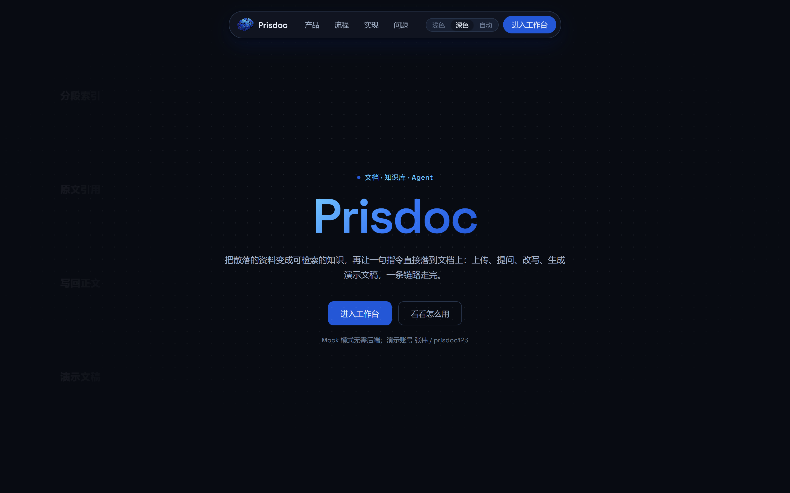
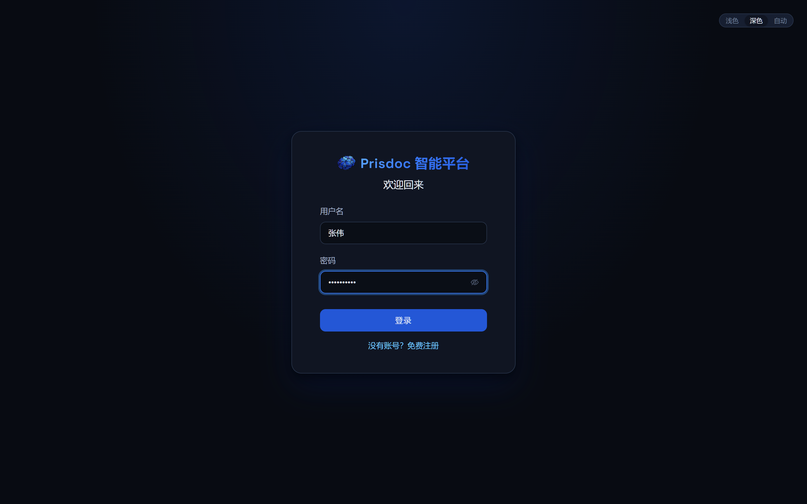
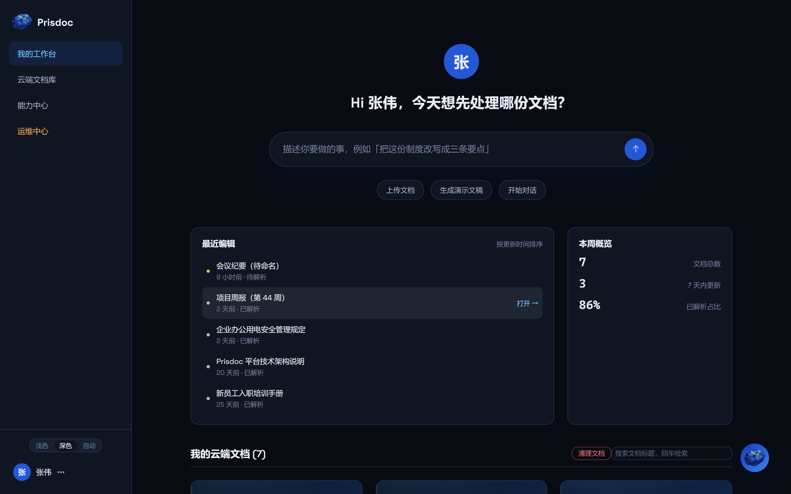
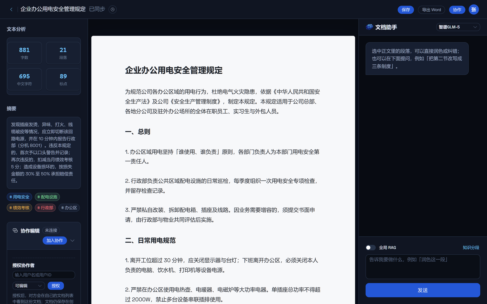
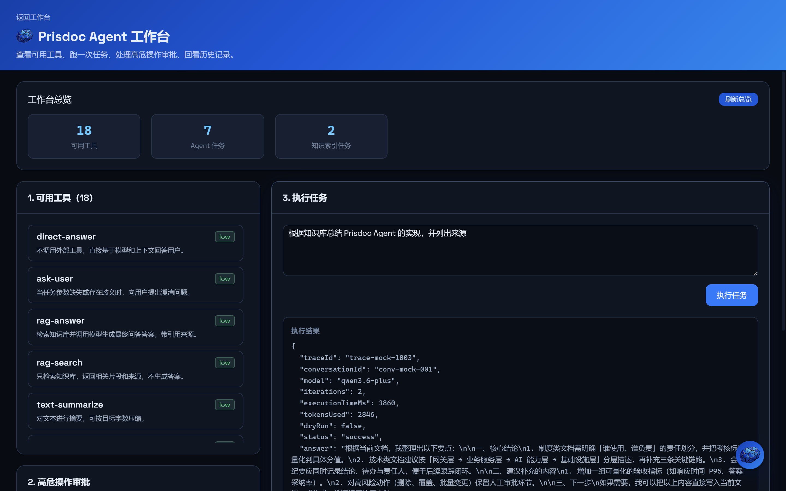
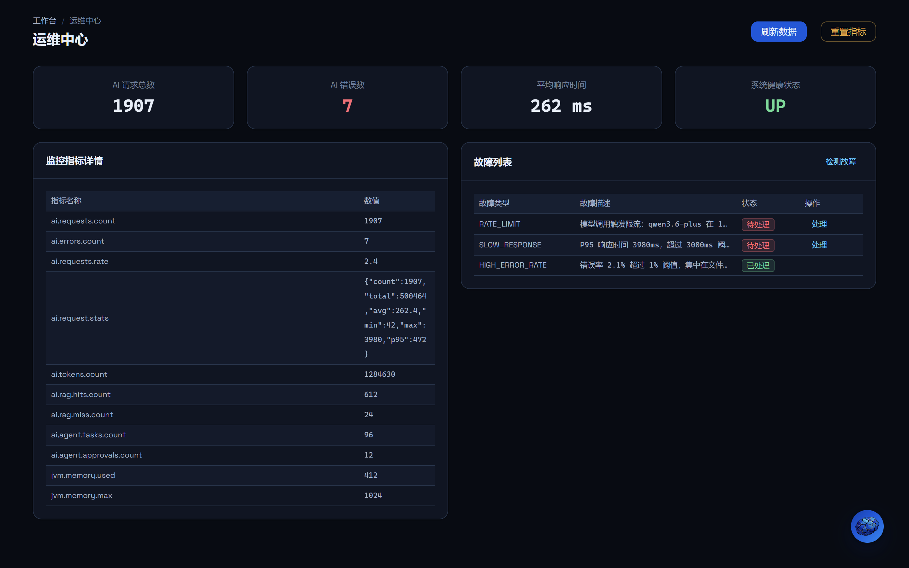
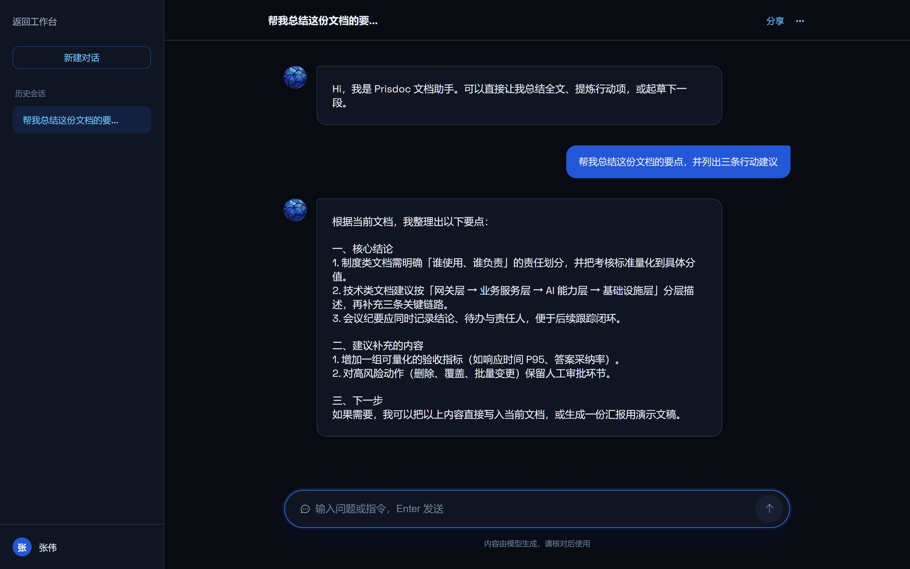
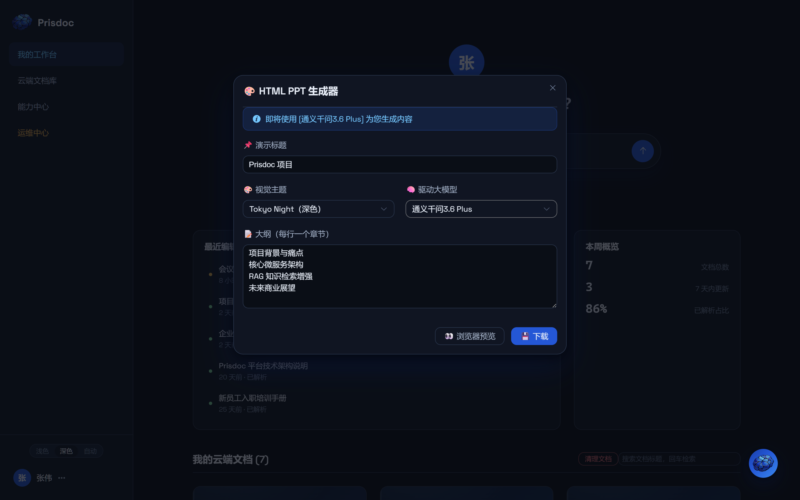
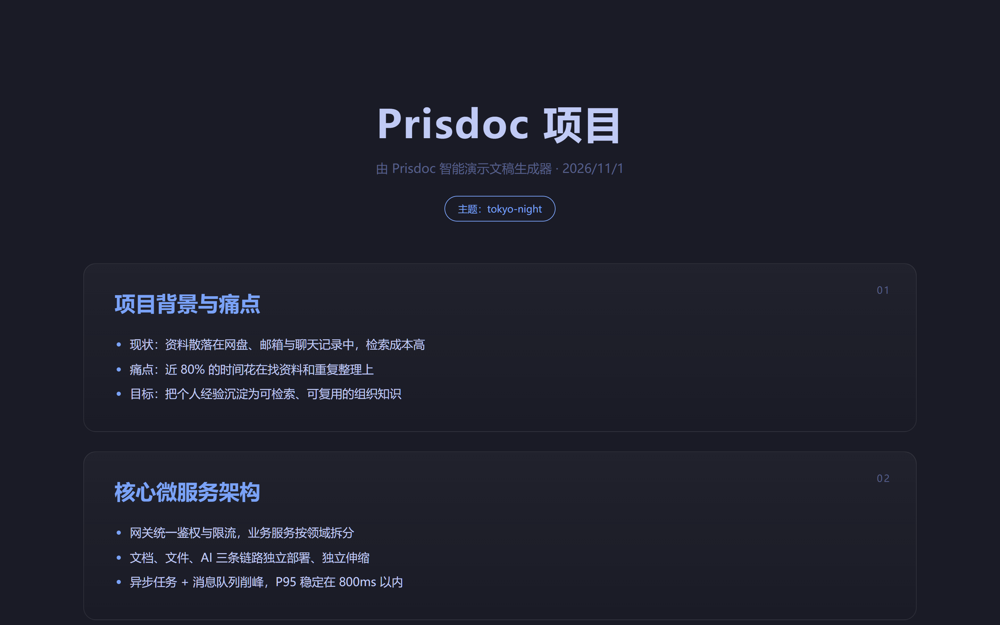
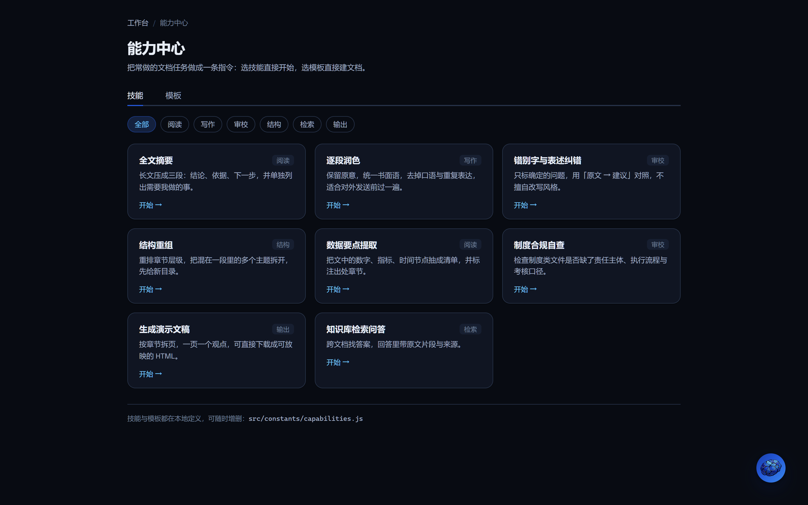

# Prisdoc Mock 模式与上手指南

> 本文解决两个问题：**16G 内存怎么把界面跑起来看**，以及**这个项目从前端到后端的使用流程长什么样**。
> 所有截图都在 [`screenshots/`](screenshots/) 目录，由 Mock 模式真实运行后截取（1440×900，2 倍像素密度）。

---

## 一、为什么原来的启动方式跑不动

Prisdoc 是标准的 Spring Cloud 微服务项目，前端只是壳，真正的工作在 5 个 Java 服务 + 4 个中间件里：

| 组件 | 端口 | 说明 |
| --- | --- | --- |
| gateway-service | 8080 | Spring Cloud Gateway，统一鉴权与路由 |
| user-service | 8081 | 注册、登录、JWT |
| file-service | 8082 | MinIO 文件上传、预览、回收站 |
| ai-service | 8083 | RAG、Agent、PPT 技能、AI Ops |
| document-service | 8084 | 文档 CRUD、版本、协作者 |
| MySQL / Redis / RabbitMQ / MinIO | 3306 / 6379 / 5672 / 9000 | 基础设施 |

一次全量启动：5 个 JVM（每个默认堆 512MB～1GB）+ MySQL + Redis + RabbitMQ + MinIO，
再加上 IDE、浏览器、Node，16G 内存基本会被打满，最常见的表现就是 `OutOfMemoryError`、容器反复重启、或者 Docker Desktop 直接把 WSL 内存吃光。

而前端真正需要的，只是 `/api/**` 返回的 JSON。

**Mock 模式做的事**：在 Vite 开发服务器里挂一个中间件，命中 `/api/**` 时直接返回本地假数据。
没有 JVM、没有数据库、没有 Docker，`npm install` 之后 3 秒起服务，内存占用几百 MB。

---

## 二、三分钟启动

```bash
cd prisdoc/vue-test-app
npm install          # 首次执行，约 150 个包
npm run dev:mock     # 关键：--mode mock
```

浏览器打开 <http://localhost:5173>，用下面的账号登录（Mock 不校验密码，任意用户名/密码都能进，用「张伟」可以看到 ADMIN 才有的运维入口）：

| 账号 | 密码 | 角色 |
| --- | --- | --- |
| 张伟 | prisdoc123 | ADMIN（可见 AI Ops 入口） |
| 李静 | prisdoc123 | USER |

### 两条命令的区别

| 命令 | 行为 | 需要什么 |
| --- | --- | --- |
| `npm run dev` | 原样保留，`/api` 走 Vite 代理到 8080 / 8083 | 真实后端全部启动 |
| `npm run dev:mock` | `/api/**` 全部由 `mock/` 下的假数据响应 | 什么都不需要 |

Mock 只在**开发服务器**生效（`apply: 'serve'`），`npm run build` 的产物里不含任何 Mock 代码。
想显式打开也可以：`VITE_MOCK=1 npm run dev`。

---

## 三、页面走查流程（按这个顺序点一遍就熟了）

### 0. 落地页


`/` 是未登录也能看的落地页：顶部悬浮胶囊导航（产品 / 流程 / 实现 / 问题 + 主题切换 + 登录），
中间一句「把资料变成可检索的知识」，下面依次是产品、流程、实现、常见问题四段。已登录时按钮会变成「进入工作台」。

### 1. 登录页


- 点「登录」→ 调用 `POST /api/users/login`，把 `accessToken` 写进 localStorage。
- 路由守卫（`src/router/index.js`）规定：没有 token 一律跳回 `/login`。
- 这里的 token 是 Mock 生成的合法 JWT，`src/utils/jwt.js` 会解出 `role: 'ADMIN'`。

### 2. 我的工作台


这是产品的主入口，对标飞书 aily：

- 顶部是「问 AI」的大输入框，回车后带着问题跳到 `/editor/chat-mode`；
- 三个胶囊按钮分别对应 **上传文档 / 生成演示文稿 / 开始对话**；
- 中间是 **最近编辑**（按 `updateTime` 倒序的 5 条，带 `2 天前 / 20 天前` 相对时间与解析状态）和 **本周概览**（文档总数 / 7 天内更新 / 已解析占比）；
- 下方是云端文档卡片，数据来自 `GET /api/documents/user/1`。

**建议动手点**：
1. 点「上传文档」，随便选一个本地文件 → 走 `POST /api/files/upload` → `POST /api/documents`，列表里会立刻多出一张卡片（Mock 会就地新建文档），「最近编辑」也会把它排到第一位。
2. 搜索框输入「周报」回车 → `GET /api/documents/search`，只剩一条。
3. 点侧栏「能力中心」→ 进技能与模板页（见本指南第 9 节）。

### 3. 文档编辑器（核心页面）


页面被切成三栏，每一栏都对应后端能力：

| 区域 | 数据来源 | 说明 |
| --- | --- | --- |
| 左侧「文本分析」 | `POST /api/ai/analyze` | 字数、段落、中文字符、标点 |
| 左侧「智能摘要 + 关键词」 | `/api/ai/async/summarize`、`/api/ai/async/keywords` | 异步任务，前端 1.2 秒轮询一次 |
| 中间 A4 纸 | `GET /api/documents/{id}` | `contenteditable`，可直接编辑 |
| 右侧 AI 助手 | `/api/ai/agent/chat/start` + Agent 执行 | 输入指令，或选中文字后点悬浮球润色 |
| 顶部「手动保存」 | `PUT /api/documents/{id}` | 保存后版本号 +1 |
| 顶部时钟图标 | `GET /api/documents/{id}/versions` | 版本回溯抽屉 |

**建议动手点**：
1. 在 A4 里改一句话 → 顶部状态变成「修改未保存」→ 点手动保存 → 提示「保存成功」。
2. 点时钟图标看版本列表，选一个 V2 恢复，正文会回滚。
3. 选中一段文字，会出现悬浮球，点「润色」——Agent 会返回一段改写文本，并由**前端**写回文档（后端不直接改文件）。

### 4. Agent 工作台


这是项目的技术亮点页，把 Agent 的「黑盒」拆成四个可见部分：

1. **工具能力 Schema**：18 个可调用工具，标注 `low / high` 风险等级；
2. **危险操作审批**：高危工具（如 `file-delete`）会中断执行并生成审批令牌；
3. **执行任务**：输入指令 → 异步任务 → 右侧出现完整 JSON（plan / toolResults / traceId）；
4. **任务历史**：按 traceId 查快照，能看到每一步的 plan 与时间线。

**建议动手点**：输入「删除过期的合同清单」，会返回 `status: "action_required"`，
令牌自动填进左侧输入框，点「确认继续」即完成审批闭环；再点「取消拒绝」体验另一种走向。

### 5. 运维中心


- 四个指标卡：请求总数、错误数、平均响应时间、健康状态；
- 左边是全部指标明细，右边是故障列表（可「检测故障」「处理」）；
- 前端每次调用 `/api/ai/**` 都会顺手上报 `ai.requests` 与耗时，点几次「刷新数据」能看到数字在涨。

### 6. 沉浸式 AI 对话


`/editor/chat-mode` 是独立的对话页：左侧会话历史，中间消息流，底部输入框（可切「全局 RAG」）。
发一句话，回的是带结构化分点的答案——这正是 Agent 的 `answer` 字段。

### 7. 生成演示文稿


标题、8 套视觉主题、驱动模型、大纲一行一个章节。点「浏览器预览」会在新窗口打开成品，
点「下载」直接得到可放映的 `.html` 文件。

### 8. 生成的演示文稿


生成物是**纯 HTML**，不依赖 Office：双击就能放映，也可以塞进 iframe 当汇报页。

### 9. 能力中心（技能 / 模板）


`/capabilities` 把「常做的文档任务」做成两条入口，都走真实链路：

| 页签 | 内容 | 点下去发生什么 |
| --- | --- | --- |
| 技能 | 8 条（摘要、润色、纠错、结构重组、数据提取、合规自查、生成演示文稿、跨文档检索），可按分类筛选 | 把写好的指令放进 `sessionStorage.global_ai_task`，跳到 `/editor/chat-mode`，Agent 直接开始执行 |
| 模板 | 6 份骨架（会议纪要、立项书、周报、制度、需求说明、复盘） | 调 `POST /api/documents` 真建一份文档，再打开 `/editor/{id}`，正文骨架已在 |

技能与模板都定义在 `src/constants/capabilities.js`，增删只改这一个文件，不需要动页面代码。

---

## 四、Mock 是怎么写进去的

```
vue-test-app/
├─ mock/
│  ├─ data.js     # 数据集：用户、6 篇文档全文、18 个工具、任务、故障、指标、PPT 模板
│  └─ index.js    # Vite 插件 + 中间件：路由表、异步任务状态机、内存状态
├─ vite.config.js # 挂载 prisdocMockPlugin({ enabled: mode === 'mock' })
└─ package.json   # 新增 dev:mock 脚本
```

几个实现要点：

1. **不碰业务代码**。`src/` 一行没改（唯一例外见第五节），Mock 完全在 Node 侧。
2. **中间件在 proxy 之前**。`configureServer` 里注册的中间件先于 Vite 内置代理执行，所以真实后端的代理配置原样保留。
3. **异步任务是真状态机**。`/api/ai/async/agent/execute` 返回 `jobId`，轮询接口前 700ms 返回 `running`，之后返回 `success`，和真实链路一致。
4. **内存态数据**。新建文档、保存正文、审批令牌、指标计数都存在内存里，所以「上传 → 保存 → 刷新列表」是连贯的；重启 dev server 即恢复初始数据。
5. **状态码与结构对齐后端**。所有响应都是 `{ code: 200, message, data }`，字段名取自 `LoginVO`、`AgentToolResult`、`AgentPlanStep` 等 Java 类。

想看当前注册了多少接口：浏览器访问 <http://localhost:5173/api/__mock__/info>。

### 调整 Mock 行为

| 想改什么 | 改哪里 |
| --- | --- |
| 接口返回内容 | `mock/data.js` 的常量 |
| 新增一个接口 | `mock/index.js` 的 `add('GET', /^\/api\/xxx$/, handler)` |
| 模拟更慢的网络 | `mock/index.js` 顶部的 `NETWORK_DELAY_MS` |
| 异步任务处理时长 | `JOB_RUNNING_MS` |

---

## 五、其它改动

- `src/collaboration/CollaboratePanel.vue`：侧边栏变窄后「协作编辑」标题与「加入协作」按钮挤在同一行，中文被压成竖排。只加了 `flex-wrap` 与 `white-space: nowrap`，属于顺手的样式修复。
- `vue-test-app/README.md`：补了 Mock 启动说明。
- 前端视觉语言整体改为 **Prisdoc 深色设计体系**（深海军蓝底 + 深钴蓝主色），令牌与组件规范见 [`DESIGN_SYSTEM.md`](DESIGN_SYSTEM.md)；本文所有截图都已按新皮肤重拍。

---

## 六、演示完想接真实后端

前端页面依赖的接口分布在 4 个服务，最小可跑组合与内存参考：

```bash
# 1) 只起基础设施
docker compose -f docker-compose-infra.yml up -d mysql redis minio rabbitmq

# 2) 起最必要的三个服务（每服务 -Xmx256m）
./mvnw -pl user-service,file-service,document-service -am spring-boot:run

# 3) 起网关
./mvnw -pl gateway-service spring-boot:run

# 4) AI 服务按需（需要有模型 API Key，否则 AI 相关页面会降级）
./mvnw -pl ai-service spring-boot:run

# 5) 前端不再用 mock
cd vue-test-app && npm run dev
```

> 只起始基础设施 + user/file/document/gateway（4 个 JVM，每个限制 256MB）大约需要 4～5GB；
> 再叠加 ai-service 的向量检索与大模型调用，建议至少 12GB 空闲内存。
> 如果只是给面试官演示界面，直接 `npm run dev:mock` 就够了。

---

## 七、简历上可以这样写（按需删改）

> **Prisdoc 智能文档平台**（Spring Cloud + Vue 3 + RAG）
> - 采用网关 + 四个微服务拆分（用户/文档/文件/AI），MinIO 存对象、MySQL 存元数据、Redis 缓存异步任务；
> - 实现基于分段的 RAG 检索（章节/固定长度/语义三种策略）+ 重排序，答案强制携带原文引用；
> - 设计 Agent 执行链路：任务规划 → 工具调用 → 高危操作人工审批 → 断点续跑，18 个工具按风险分级；
> - 前端实现编辑器、协同、Agent 工作台与 AI Ops 看板；另外提供零后端依赖的 Mock 模式，便于演示与联调。

> 演示地址（本地）：`npm run dev:mock` → <http://localhost:5173>，账号 `张伟 / prisdoc123`。

---

## 八、常见问题

**Q：端口 5173 被占用。**
`npm run dev:mock -- --port 5174`，或者先关掉旧的 Node 进程。

**Q：改了 `mock/` 下的文件没生效。**
Mock 插件在服务启动时加载，改完需要重启 `npm run dev:mock`（页面热更新只对 `src/` 生效）。

**Q：页面上出现「服务器开了小差」。**
说明有接口没被 Mock 覆盖。看终端日志里的 `[prisdoc-mock] 未定义的接口 ...`，在 `mock/index.js` 里补一条路由即可。

**Q：想清空演示数据。**
刷新页面即可重置前端状态；文档/指标的改动重启 dev server 就恢复。

**Q：能在手机或别的电脑上看吗？**
`npm run dev:mock -- --host`，然后用局域网 IP 访问。

---

## 九、主题（浅色 / 深色 / 自动）

三个入口都能切：落地页胶囊导航、登录/注册页右上角、工作台侧栏底部（三段式胶囊：浅色 / 深色 / 自动）。
选择存在 `localStorage.prisdoc-theme`，刷新后保留；选「自动」时跟随系统 `prefers-color-scheme`，系统切换会实时生效。

颜色全部来自 `src/styles/prisdoc-tokens.css` 里的 `--pd-*` 令牌，组件代码里没有一行判断主题；
`src/utils/theme.js` 只负责在 `<html>` 上写 `data-theme`（深色时额外挂 `html.dark`，让 Element Plus 的暗色变量表生效）。
首屏由 `index.html` 里的内联脚本先把主题定好，避免亮色用户看到一闪而过的深色底。

亮色截图见 `screenshots/12-login-light.png`、`13-landing-light.png`、`10-dashboard-light.png`、`11-editor-light.png`。
