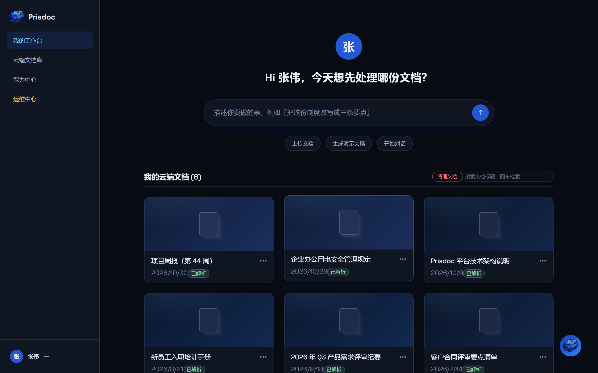
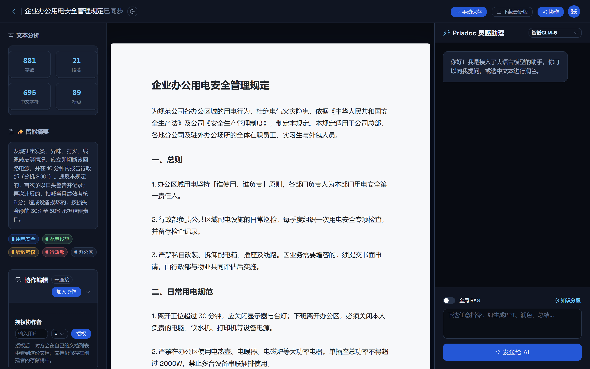
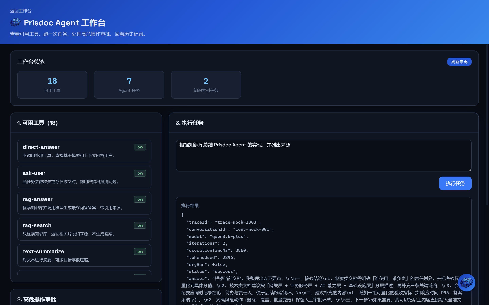
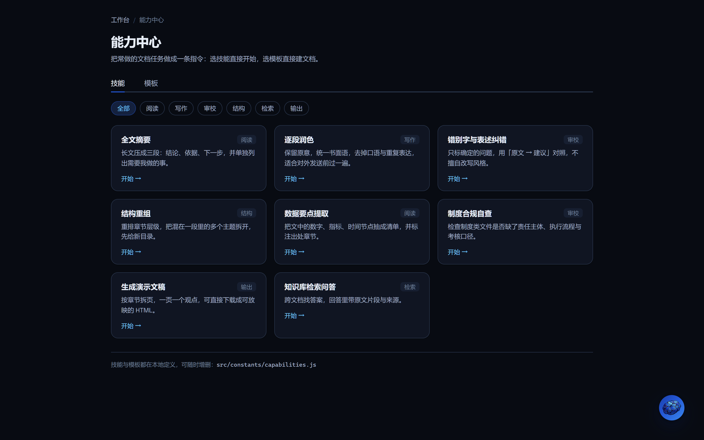
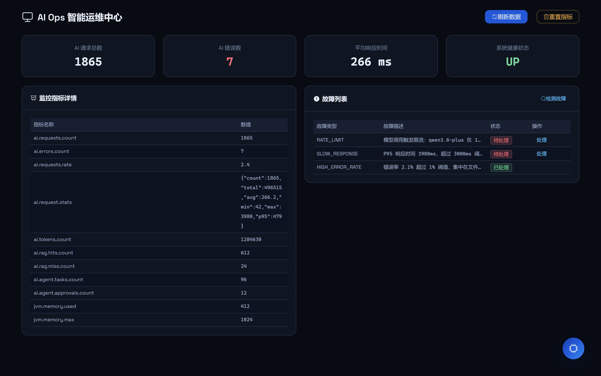
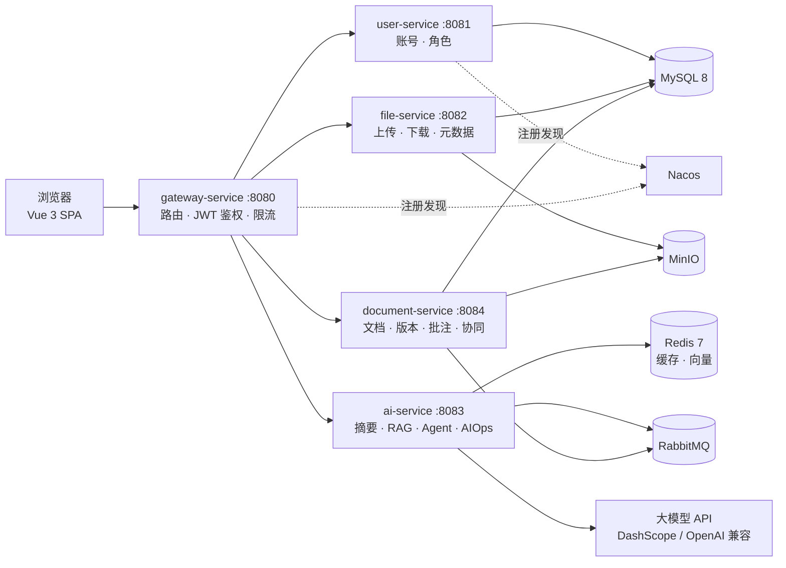

<div align="center">


<h1>Prisdoc</h1>

<p><strong>智能文档平台 · Spring Cloud × Vue 3 × RAG × Agent</strong></p>

<p>写文档、发批注、问知识库、让 Agent 把活干完 —— 一套能本地跑通的文档智能工作台。</p>

<p>
  <a href="https://github.com/Prisdvl/Prisdoc"></a>
  
  
  
  
  
  
  
  
  
  
  
  
</p>

</div>

<p align="center">
  
</p>

---

## 目录

- [项目简介](#项目简介)
- [功能亮点](#功能亮点)
- [界面预览](#界面预览)
- [系统架构](#系统架构)
- [技术栈](#技术栈)
- [快速开始](#快速开始)
- [模块与接口](#模块与接口)
- [目录结构](#目录结构)
- [文档](#文档)
- [许可证](#许可证)

## 项目简介

Prisdoc 是一套面向团队的智能文档平台。后端由 Spring Cloud 微服务组成（用户、文件、AI、文档、网关），
前端是 Vue 3 + Element Plus 的单页应用，覆盖「写作 → 批注 → 版本 → 知识库 → Agent 自动化」的完整链路。

- **不用装数据库也能看**：前端内置零后端 Mock 模式，`npm run dev:mock` 一条命令跑通全部页面。
- **真实的微服务骨架**：Nacos 注册发现、网关鉴权、OpenFeign 调用、Sentinel 限流、RabbitMQ 异步任务。
- **AI 是主角而非点缀**：摘要 / 纠错 / 关键词、RAG 知识库问答、多步 Agent 规划与工具调用，危险操作走人工审批。

## 功能亮点

| 能力 | 说明 |
| --- | --- |
| 账号与鉴权 | 注册、登录、刷新令牌；网关统一校验 JWT，白名单放行登录/注册/刷新。 |
| 文件中心 | 上传（含分片）、下载、预览、重命名、元数据管理、回收站与版本快照，文件落在 MinIO。 |
| 在线编辑器 | A4 纸面编辑、自动保存、版本历史与恢复、批注与评论、协作者授权。 |
| 实时协同 | WebSocket/STOMP 广播编辑操作与光标位置，多人在线状态可见。 |
| AI 助手 | 文档摘要、纠错、关键词提取，支持多模型切换（通义千问 / GLM / Kimi / MiniMax）。 |
| RAG 知识库 | 文档分段与向量化，HNSW 近邻检索 + BM25 融合重排，回答可溯源到片段。 |
| Agent 工作台 | 规划 → 调工具 → 反思重规划，工具调用可视化；危险操作走服务端一次性审批令牌。 |
| AIOps 运维 | 请求量/耗时/错误率指标、故障指纹聚合告警、熔断与自动恢复建议。 |
| 演示文稿 | 由大纲生成 HTML 版 PPT，支持主题切换、在线预览与导出。 |
| 主题系统 | 深色 / 浅色 / 跟随系统三态，全部颜色走设计令牌（A4 纸面始终为浅色）。 |

## 界面预览

<table>
  <tr>
    <td width="50%"></td>
    <td width="50%"></td>
  </tr>
  <tr>
    <td align="center"><sub>文档编辑器：纸面写作 + AI 侧栏 + 版本历史</sub></td>
    <td align="center"><sub>Agent 工作台：任务规划、工具调用与结果审阅</sub></td>
  </tr>
  <tr>
    <td width="50%"></td>
    <td width="50%"></td>
  </tr>
  <tr>
    <td align="center"><sub>能力中心：技能与模板一键直达</sub></td>
    <td align="center"><sub>AIOps：指标、健康度与故障记录</sub></td>
  </tr>
</table>

<p align="center"><sub>另有登录页、AI 对话模式、PPT 预览与「浅色主题」截图，见 <a href="docs/screenshots/">docs/screenshots</a>。</sub></p>

## 系统架构



请求统一从网关进入，由 `AuthGlobalFilter` 解析 JWT 并向下游透传用户身份；
耗时较长的 AI 推理通过 RabbitMQ 转为异步任务，前端轮询任务状态，避免长连接阻塞。

## 技术栈

| 层次 | 选型 |
| --- | --- |
| 框架 | Spring Boot 3.2.0、Spring Cloud 2023.0.3、Spring Cloud Alibaba 2023.0.1.0 |
| 数据访问 | MyBatis-Plus 3.5.5、MySQL 8.0 |
| 中间件 | Redis 7（缓存 / 向量）、RabbitMQ（异步任务 / 事件）、MinIO（对象存储）、Nacos（注册发现） |
| 安全 | Spring Security、JWT 0.11.5、网关全局过滤器、Sentinel 限流 |
| AI | Spring AI、DashScope（通义千问）、OpenAI 兼容协议、HNSW + BM25 混合检索 |
| 文档处理 | Apache POI、PDFBox、Tesseract OCR、LCS 文本 diff |
| 前端 | Vue 3.5、Vite 4.5、Element Plus 2.14、Vue Router、Axios |
| 工程化 | Docker Swarm、Maven、npm、Prometheus |

## 快速开始

### 方式一：只跑前端（零后端，约 3 分钟）

不启动任何后端服务，用内置 Mock 数据走通全部页面：

```bash
cd vue-test-app
npm install
npm run dev:mock
```

打开 <http://localhost:5173>，任意账号密码即可登录。
页面走查顺序与 Mock 原理见 [docs/MOCK_MODE_GUIDE.md](docs/MOCK_MODE_GUIDE.md)。

### 方式二：完整部署（Docker Swarm）

```bash
# 1) 准备：Docker 26+、JDK 17、Maven 3.8+、Node 18+
git clone https://github.com/Prisdvl/Prisdoc.git && cd Prisdoc

# 2) 按 .env.example 填写节点地址、数据库与中间件密码，并导出为环境变量
cp .env.example .env
set -a; source .env; set +a

# 3) 构建镜像并部署（建网络/卷 → 构建镜像 → docker stack deploy）
chmod +x deploy.sh
./deploy.sh
```

| 服务 | 端口 | 说明 |
| --- | --- | --- |
| 前端 | 5173（开发） | Vite 开发服务器；生产可由 Nginx 托管 `dist/` |
| 网关 | 8080 | 所有 `/api/**` 的统一入口 |
| 用户服务 | 8081 | Swagger UI：`/swagger-ui.html` |
| 文件服务 | 8082 | 同上 |
| AI 服务 | 8083 | 同上 |
| 文档服务 | 8084 | 同上 |
| Nacos | 8848 / 9848 / 9849 | 控制台 `/nacos`，必须映射 gRPC 端口 |
| MinIO | 9000 / 9001 | 9001 为控制台 |
| RabbitMQ | 5672 / 15672 | 15672 为控制台 |

完整步骤、集群初始化与故障排查见 [DEPLOY.md](DEPLOY.md) 与 [INSTALLATION_AND_USAGE.md](INSTALLATION_AND_USAGE.md)。

## 模块与接口

| 模块 | 职责 | 路由前缀 |
| --- | --- | --- |
| `common` | 公共返回体、异常、JWT、Redis/Feign/Swagger 配置 | — |
| `gateway-service` | 路由转发、JWT 鉴权、跨域、限流 | `/api/**` → 下游 |
| `user-service` | 注册、登录、令牌刷新、用户查询 | `/api/users/**` |
| `file-service` | 上传、下载、预览、元数据、回收站 | `/api/files/**` |
| `ai-service` | 摘要/纠错/关键词、RAG、Agent、AIOps、技能 | `/api/ai/**`、`/api/skills/**` |
| `document-service` | 文档 CRUD、版本、批注、评论、协同 | `/api/documents/**` |
| `vue-test-app` | 单页应用（含 Mock 插件） | — |

数据库脚本见 [mysql-schema.sql](mysql-schema.sql)，消息队列设计见 [RABBITMQ_IMPLEMENTATION.md](RABBITMQ_IMPLEMENTATION.md)。

## 目录结构

```text
Prisdoc/
├── common/                  # 公共组件：统一返回、异常、JWT、Redis、Feign、Swagger
├── gateway-service/         # API 网关：路由、鉴权过滤器、跨域、限流
├── user-service/            # 用户服务：注册/登录/令牌
├── file-service/            # 文件服务：MinIO 存储、分片上传、元数据
├── ai-service/              # AI 服务：摘要、RAG、Agent、AIOps、技能、异步任务
├── document-service/        # 文档服务：文档、版本、批注、评论、协同编辑
├── vue-test-app/            # Vue 3 前端（src/ 业务代码，mock/ 零后端插件）
├── docs/                    # 设计系统、Mock 指南、注释规范、界面截图
├── docker-compose-*.yml     # 基础设施 / 服务 / 监控编排
├── deploy.sh                # 一键部署脚本
└── pom.xml                  # 父 POM
```

## 文档

| 文档 | 内容 |
| --- | --- |
| [docs/MOCK_MODE_GUIDE.md](docs/MOCK_MODE_GUIDE.md) | 零后端启动、页面走查路线、Mock 原理 |
| [docs/DESIGN_SYSTEM.md](docs/DESIGN_SYSTEM.md) | 设计令牌、组件规范、明暗主题约定 |
| [docs/CODE_COMMENT_SPEC.md](docs/CODE_COMMENT_SPEC.md) | 代码注释规范（Java / JS / Vue） |
| [DEPLOY.md](DEPLOY.md) | Docker Swarm 部署、扩缩容、备份 |
| [INSTALLATION_AND_USAGE.md](INSTALLATION_AND_USAGE.md) | 安装与功能使用指南 |
| [RABBITMQ_IMPLEMENTATION.md](RABBITMQ_IMPLEMENTATION.md) | 消息队列实现与验证 |

## 许可证

[MIT License](LICENSE) © Prisdvl
